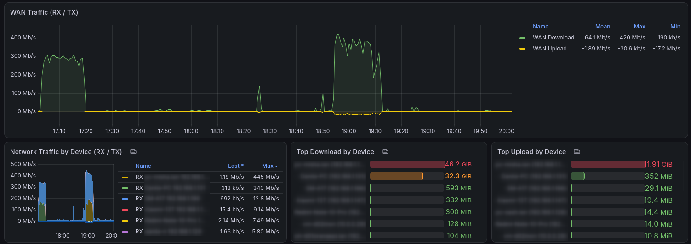

# nlbwmon — одновременный экспорт соединений в OpenSearch и метрик Prometheus

**Установка:** [INSTALL на русском](INSTALL.ru.md) | [English](INSTALL.md)

[English](README.md) | **Русский**

## Авторство, использование ИИ и зрелость

Автор проекта — DevOps/инфраструктурный инженер с большим опытом Linux и сетей, но ограниченным опытом профессиональной разработки программ. Изменения C-кода, скриптов сборки и развёртывания создавались со значительной помощью инструментов ИИ; архитектура, развёртывание и испытания выполнялись в собственной лаборатории. Независимого аудита безопасности и широкой проверки совместимости пока нет.

**Версия: `v0.1.0-beta.1` (кандидат beta-релиза из исходников; Git-тег и GitHub Release ещё не созданы). Статус: экспериментальная beta.** Работающий экспорт в OpenSearch и параллельное сохранение метрик nlbwmon не доказывают полноту событий, корректность всех NAT-сценариев или совместимость с любыми версиями OpenWrt, OpenSearch и Prometheus. Предназначено прежде всего для лаборатории и self-hosting.

**Важно:** события в OpenSearch передаёт отдельный Python-агрегатор, а метрики Prometheus предоставляет независимый Lua-коллектор поверх обычного учёта nlbwmon. Сам форк не подключается напрямую ни к OpenSearch, ни к Prometheus.

## Два независимых потока данных: OpenSearch и Prometheus/Grafana

Наш форк **сохраняет стандартный учёт nlbwmon** и добавляет экспериментальный экспорт событий соединений. В одной установке можно использовать оба направления одновременно:

| Назначение | Путь данных | Компонент |
| --- | --- | --- |
| События отдельных соединений, NEW/DESTROY, адреса, порты, NAT | `nlbwmon → TCP JSONL → Python nlbwmon-aggregator → OpenSearch` | Разработка этого проекта и связанного агрегатора |
| Метрики трафика по устройствам, приём/передача, количество соединений | `nlbwmon → nlbw -c csv → сторонний Lua collector → prometheus-node-exporter-lua → Prometheus/VictoriaMetrics → Grafana` | **Сторонняя разработка giuliomagnifico**, не включена в APK |

**Автор Lua-коллектора и исходного примера панели Grafana — [giuliomagnifico](https://github.com/giuliomagnifico/openwrt-nlbwmon-prometheus-collector).** Это независимый компонент, который не модифицировался и не входит в наш форк. Его метрики: `nlbwmon_rx_bytes`, `nlbwmon_tx_bytes`, `nlbwmon_connections`.

**Grafana:** [наш адаптированный JSON-шаблон](grafana/openwrt-nlbwmon-dashboard.json) (на основе пользовательской панели OpenWrt; с выбором WAN-интерфейса) · [инструкция установки и импорта на русском](docs/ru/PROMETHEUS_GRAFANA.md) · [оригинальный пример стороннего автора](https://github.com/giuliomagnifico/openwrt-nlbwmon-prometheus-collector/blob/main/Grafana%20dashboard%20example.json). **При импорте необходимо назначить собственный Prometheus/VictoriaMetrics datasource**: в публикуемом JSON вместо частного UID указан `PROMETHEUS_DATASOURCE_UID`. Выбор интерфейса `WAN interface` проверен пользователем; по умолчанию `pppoe-wan`.

## Зачем создан форк

Оригинальный [nlbwmon (jow-)](https://github.com/jow-/nlbwmon) учитывает трафик устройств в OpenWrt. Нам понадобилось одновременно использовать данные conntrack для двух задач:

- **Prometheus / Grafana:** сохранить существующий учёт трафика по устройствам. Метрики предоставляет отдельный [Prometheus collector](https://github.com/giuliomagnifico/openwrt-nlbwmon-prometheus-collector).
- **OpenSearch:** собирать подробные события соединений (адреса, порты, протоколы, время и счётчики трафика) с помощью отдельного Python-проекта [nlbwmon-aggregator](https://github.com/anideth/nlbwmon-aggregator).

**Проблема:** два независимых сборщика conntrack могли мешать друг другу. Операция `GET_CTRZERO` **читает и одновременно обнуляет счётчики в ядре**. После первого сборщика второй мог увидеть нули или неполные значения.

**Решение:** встроить необязательный экспортёр в сам nlbwmon и использовать его существующую обработку conntrack, не создавая второго конкурирующего опросчика. Экспортёр формирует JSONL-события `NEW` и `DESTROY` и отправляет их по TCP. Python-коллектор может сохранять принятые события в SQLite и передавать обновления в OpenSearch.

Экспорт **выключен по умолчанию**. Доставка выполняется по принципу best-effort: события могут теряться. Это не гарантированно полный журнал.

Подробности: [обзор проекта](docs/ru/OVERVIEW.md). Оригинальная документация родительского проекта сохранена ниже и переведена на русский.

---

> **Исходники beta (18.11.2026):** см. [контрольный список beta-релиза, требования к памяти, политику conntrack mark и указание сторонних авторов](docs/BETA_RELEASE_CHECKLIST.md). Настроенный Netlink-буфер 524288 байт — это **512 КиБ, а не требование 512 МиБ оперативной памяти роутера**. Это beta из исходников: готовых APK для разных роутеров нет. Git-тег и GitHub Release пока не опубликованы.

> [!CAUTION]
> **ЭКСПЕРИМЕНТАЛЬНЫЙ ФОРК — НЕ ГОТОВ К ПРОМЫШЛЕННОМУ ИСПОЛЬЗОВАНИЮ.**
>
> В этой ветке есть незавершённые и не полностью проверенные изменения учёта conntrack и экспорта соединений. Данные могут теряться, дублироваться, приписываться неверным соединениям или учитываться некорректно. **Не используйте проект для аудита безопасности, биллинга, соблюдения нормативных требований или других задач, требующих точных и полных данных.**
>
> События NEW/DESTROY доставляются без гарантий: потери событий ядра, перезапуски демона, переполнение очереди, разрывы TCP и ошибки приёмника могут приводить к пропущенным или повторным записям. Ограниченные лабораторные испытания, включая восстановление после переполнения Netlink-приёмника, пройдены. Полнота сквозного сбора, длительная стабильность и безопасность эксплуатации пока не подтверждены.
>
> **Используйте только в изолированной лаборатории, если не понимаете все риски.** Сохраните конфигурацию OpenWrt и базу учёта, исходный пакет и проверенный способ отката. Это неофициальный форк, не одобренный авторами оригинального проекта или OpenWrt.

> **Неофициальный форк [jow-/nlbwmon](https://github.com/jow-/nlbwmon).** Оригинальный механизм учёта трафика сохранён. Экспорт соединений экспериментальный, **по умолчанию выключен** и проверяется в лаборатории. Это не официальный пакет OpenWrt.

Форк добавляет события отдельных соединений к существующему учёту Linux conntrack. Используется тот же Netlink-путь, без второго опросчика, сбрасывающего счётчики. Завершённые соединения можно передавать в виде JSONL по TCP.

## Версии и статус релиза

**Версия исходников beta — `v0.1.0-beta.1`.** Соответствующий Git-тег и GitHub Release ещё предстоит опубликовать; запись версии в документации не означает наличия тега. До этого сборку следует идентифицировать по Git-коммиту. Версия официального пакета OpenWrt не равна версии форка.

- Основная ветка разработки: `feature/flow-lifecycle-events`; `master` сохраняется для синхронизации с upstream.
- Предварительные версии форка используют SemVer (`v0.1.0-beta.1` и последующие beta); это не означает готовность к production.
- Схема передаваемых событий `nlbwmon-flow-v1` не зависит от версии Git-релиза.
- См. [CHANGELOG.md](CHANGELOG.md), [версии](docs/VERSIONING.md), [ограничения](docs/limitations.md), [лабораторную проверку](docs/lab-validation-2026-11-13.md).

Подробности воспроизводимой сборки APK для двух архитектур, отличий пакета, мер безопасности и отката: [сборка и откат](docs/BUILD_AND_ROLLBACK.md). Версия alpha-пакета — `0.1.0_alpha1-r1`, она отличается от официальной версии OpenWrt. **Это beta из исходников, готовые APK не распространяются. Автоматический откат не гарантирован.**

## Что добавлено в форке

- Отслеживание соединений по событиям conntrack NEW, периодическим снимкам счётчиков (`GET_CTRZERO`) и DESTROY.
- Исходные и ответные адреса/порты, включая NAT, а также объёмы трафика и пакетов по направлениям.
- Фильтр conntrack `mark/mask` и ограниченная по размеру таблица соединений в памяти.
- Необязательная неблокирующая TCP-отправка с ограниченной очередью и повторным подключением.
- Необязательная секция UCI `config flow_export`, выключенная по умолчанию.
- Тесты парсера и транспорта, включая запуск ARM64-тестов через QEMU.

**Ограничения:** TCP-доставка best-effort, без прикладного подтверждения, постоянной очереди и дедупликации. При недоступности приёмника или переполнении очереди события могут пропадать. Это не надёжный журнал аудита. Учитываются только соединения, соответствующие `mark/mask`; полнота зависит от conntrack. Не запускайте два независимых `GET_CTRZERO`-опросчика одной таблицы.

## Быстрая настройка (OpenWrt)

Пример UCI находится в [openwrt/files/nlbwmon.config](openwrt/files/nlbwmon.config), соответствующий procd init-скрипт — [openwrt/files/nlbwmon.init](openwrt/files/nlbwmon.init). При сборке через SDK рецепт пакета должен установить **оба файла**: компиляция исходников сама по себе не заменяет файлы из официального feed.

```uci
config flow_export
    option enabled '0'
    option mark '0x40000000'
    option mark_mask '0x40000000'
    option max_flows '16384'
    option tcp_host ''
    option tcp_port ''
    option tcp_queue_size '1024'
    option tcp_reconnect_interval '5'
```

Для отправки по TCP установите `enabled=1` и задайте **оба** параметра `tcp_host` и `tcp_port`. Приёмник должен читать JSON-объекты, разделённые переводом строки. TCP не шифруется и не аутентифицируется; используйте доверенную сеть или защищённый туннель.

См. [настройку и протокол](docs/FLOW_EXPORT.md), [ограничения и риски](docs/limitations.md).

## Мониторинг трафика устройств в Prometheus (необязательно)

JSONL-экспортёр соединений и Prometheus collector для nlbwmon — **разные независимые компоненты**. Первый экспериментальный, по умолчанию выключен и не является экспортёром Prometheus. Второй читает обычный вывод `nlbw -c csv`. **Prometheus collector не входит ни в APK nlbwmon, ни в пакеты prometheus-node-exporter-lua.**

Для мониторинга в Grafana используйте сторонний [OpenWrt nlbwmon Prometheus collector от giuliomagnifico](https://github.com/giuliomagnifico/openwrt-nlbwmon-prometheus-collector). См. [инструкции установки, проверки, резервирования и восстановления после обновления](docs/PROMETHEUS_AND_BACKUP.md). Он предоставляет `nlbwmon_rx_bytes`, `nlbwmon_tx_bytes` и `nlbwmon_connections` с метками `family`, `proto`, `port`, `mac`, `ip`, `hostname`, `layer7`. Примеры Grafana доступны в репозитории автора. Код и обновления этого сборщика не поддерживаются нашим форком.

После установки необходимых пакетов и создания каталога сборщиков:

```sh
wget -O /usr/lib/lua/prometheus-collectors/nlbwmon.lua https://raw.githubusercontent.com/giuliomagnifico/openwrt-nlbwmon-prometheus-collector/main/nlbwmon.lua && /etc/init.d/prometheus-node-exporter-lua restart
```

Обновление прошивки с сохранением конфигурации **не гарантирует** сохранения вручную установленных файлов в `/usr/lib` и дополнительных пакетов. Перед `sysupgrade` следуйте инструкции резервирования по ссылке выше.


<details>
<summary>Показать скриншот панели Grafana</summary>



*Пример панели Grafana. [JSON-шаблон с выбором WAN-интерфейса](grafana/openwrt-nlbwmon-dashboard.json) · [инструкция по настройке и импорту](docs/ru/PROMETHEUS_GRAFANA.md).*

</details>

## Статус и совместимость

- **Ветка разработки:** `feature/flow-lifecycle-events`; `master` оставляем для синхронизации с upstream.
- **Проверенная сборка:** OpenWrt SDK 25.12.6, `mediatek/filogic`, `aarch64_cortex-a53`.
- **Тесты:** синтетический интеграционный тест парсера conntrack под QEMU, локальные модульные/транспортные тесты, ограниченные тесты трафика в лабораторной OpenWrt x86-64.
- **Подтверждено в лаборатории:** JSONL NEW, повторное подключение после простоя, ограничение очереди, передача накопленных строк после восстановления связи. После 3158 потерь Netlink-сообщений сокет событий оставался зарегистрированным; 30 последующих тестовых соединений дали соответствующие пары NEW/DESTROY без перезапуска демона. **Потерянные события не восстанавливались.** Не проверены полностью: точность сквозного учёта, все варианты NAT/IPv6, длительная стабильность и обновление со штатного пакета.
- **Бинарные пакеты:** публиковать только как явно обозначенные предварительные версии после проверки содержимого APK и процедуры установки. APK нельзя считать совместимым с другими выпусками OpenWrt или архитектурами.

## Исходный проект

Форк предполагается поддерживать совместимым с [оригинальным проектом](https://github.com/jow-/nlbwmon). Исправления парсера, механизм экспорта и транспорт следует предлагать upstream отдельными небольшими изменениями, если появится такая возможность. Далее — **перевод исходной документации nlbwmon**; оригинальный английский текст сохранён в [README.md](README.md#original-nlbwmon-documentation-upstream).

---

# Документация оригинального nlbwmon (перевод)

## Описание

nlbwmon предназначен для учёта трафика сетевых устройств на Linux-роутере. Статистика сохраняется в базе данных; клиентская утилита `nlbw` позволяет запрашивать её у демона.

По умолчанию учёт ведётся за месячные периоды, начиная с первого числа. Для каждого периода хранится отдельная база данных, обычно до 10 баз; самые старые затем удаляются.

Трафик учитывается по версии IP (IPv4/IPv6), IP-адресу, MAC-адресу и прикладному протоколу (определяемому по портам). Все данные сохраняются в базе. Стандартный файл описаний протоколов содержит примерно 45 портов; список можно изменять. Трафик, не соответствующий ни одному описанию, относится к категории `Other`.

*Примечание: если классификация по прикладным протоколам не нужна, удаление их описаний из файла переведёт весь трафик в категорию `Other` и заметно уменьшит размер базы.*

nlbwmon получает сведения из Linux conntrack через Netlink. Это достаточно эффективный способ сбора статистики. При периодическом опросе счётчики conntrack читаются и обнуляются (zero-on-read). При уничтожении записи conntrack ядро уведомляет nlbwmon, который успевает получить её итоговые счётчики.

## Использование

### nlbwmon

*Примечание: для LEDE/OpenWrt предусмотрены init-скрипт и файл UCI-конфигурации. См. `/etc/config/nlbwmon`.*

| Параметр | Назначение |
| --- | --- |
| `-i sec` | Интервал сохранения базы из памяти на диск, в секундах |
| `-r sec` | Интервал опроса записей conntrack |
| `-s network` | Подсеть, трафик которой нужно учитывать |
| `-o /path/to/database-folder` | Каталог файлов баз данных |
| `-p /path/to/protocol-file` | Файл описаний протоколов по номеру IP-протокола и порту |
| `-G count` | Максимальное число сохраняемых поколений баз; по умолчанию 10 |
| `-I interval` | Период учёта: день месяца или `YYYY-MM-DD/NN` для интервалов по NN дней |
| `-P` | Предварительно выделять максимально возможный объём памяти для базы; действует только вместе с ограничением размера базы |
| `-Z` | Сжимать архивные базы gzip; экономит место, но замедляет чтение старых данных |

Примеры `-I`:

```text
2017-01-17/14   # каждые 14 дней, начиная с 17 января 2017
-2              # предпоследний день месяца
1               # первый день месяца (по умолчанию)
```

### nlbw

*Примечание: ниже приведены примеры использования.*

| Параметр | Назначение |
| --- | --- |
| `-S /path/to/domain.socket` | Путь к Unix-сокету (по умолчанию `/var/run/nlbwmon.sock`) |
| `-c command` | Команда: `show`, `json`, `csv`, `list`, `commit` |
| `-p /path/to/protocol-database` | Файл описаний протоколов |
| `-g col[,col]` | Группировать по столбцам; знак `-` меняет направление сортировки |
| `-o col[,col]` | Сортировать по столбцам; знак `-` меняет направление |
| `-t YYYY-MM-DD` | Читать базу указанного периода вместо текущей |
| `-n` | Выводить числа без преобразования в K, M, G и т. п. |
| `-s char` | Разделитель CSV; без значения — пустая строка |
| `-q char` | Символ кавычек CSV; без значения — пустая строка |
| `-e char` | Символ экранирования CSV; без значения — пустая строка |

### Команды nlbw

- **`show`** — статистика в удобном для чтения виде.
- **`json`** — статистика в формате JSON.
- **`csv`** — статистика в формате CSV.
- **`list`** — список доступных баз; нужную можно выбрать через `-t`.
- **`commit`** — сохранить данные из оперативной памяти в базу на диске, например перед перезагрузкой.

## Подключение репозитория как package feed

Для сборки оригинального nlbwmon в окружении LEDE/OpenWrt можно подключить репозиторий автора:

```sh
cp feeds.conf.default feeds.conf
echo "src-git nlbwmon https://github.com/jow-/nlbwmon.git" >> feeds.conf
./scripts/feeds update nlbwmon
./scripts/feeds install nlbwmon
```

**Важно:** команды выше относятся к **оригинальному** проекту, а не к сборке нашего форка. Инструкция сборки форка: [BUILD_AND_ROLLBACK.md](docs/BUILD_AND_ROLLBACK.md).

## Примеры

Ниже сохранены примеры команд и вывода из документации оригинального проекта. Это демонстрационные данные автора, **не сведения о нашей сети**.


После установки пакета команда `nlbw` выводит накопленную статистику:

    root@jj:~# nlbw -c show
      Fam            Host (    MAC )      Layer7      Conn.   > Downld. ( > Pkts. )      Upload (   Pkts. )
    IPv4       10.11.12.7 (47:e1:b9)       HTTPS       111      2.99 MB (   4.38 K)   816.77 KB (   5.86 K)
    IPv6  2001:470:527e::6666:b3ff:fe47:e1b9 (47:e1:b9)       HTTPS        14    546.07 KB (     930 )   196.05 KB (     932 )
    IPv6  2001:470:527e::6666:b3ff:fe47:e1b9 (47:e1:b9)        HTTP        15    296.07 KB (     194 )    28.67 KB (     329 )
    IPv4     10.11.12.167 (a3:5c:1c)       HTTPS        24    210.53 KB (     299 )    61.86 KB (     400 )
    IPv4      10.11.12.17 (2c:97:19)       HTTPS        31    163.54 KB (     481 )   352.28 KB (     593 )
    IPv4       10.11.12.7 (47:e1:b9)       other       353    104.52 KB (     610 )    64.79 KB (     709 )
    IPv4      10.11.12.15 (94:59:06)       HTTPS         6     49.48 KB (      85 )    18.36 KB (     103 )
    IPv4       10.11.12.7 (47:e1:b9)        HTTP        24     14.24 KB (     152 )    16.89 KB (     177 )
    IPv4     10.11.12.167 (a3:5c:1c)       other        15      6.03 KB (      80 )     5.73 KB (      68 )
    IPv4      10.11.12.17 (2c:97:19)       other        11        800 B (      16 )     3.11 KB (      47 )
    IPv6  2001:470:527e::6666:b3ff:fe47:e1b9 (47:e1:b9)   IPv6-ICMP         1        728 B (       7 )     5.68 KB (      56 )
    IPv4      10.11.12.17 (2c:97:19)        HTTP         1        456 B (       5 )       450 B (       6 )
    IPv4       10.11.12.7 (47:e1:b9)        ICMP         1        420 B (       5 )       420 B (       5 )
    IPv4      10.11.12.15 (94:59:06)       other         3        228 B (       3 )       228 B (       3 )
    IPv6  2001:470:527e::a886:c6fc:82a4:bba9 (2c:97:19)        HTTP         1         80 B (       1 )       144 B (       2 )
    IPv6  2001:470:527e::a886:c6fc:82a4:bba9 (00:00:00)        HTTP         2          0 B (       0 )         0 B (       0 )
    IPv6  2001:470:527e::1 (35:88:49)        HTTP        18          0 B (       0 )     1.64 KB (      21 )

Параметры `-g` (группировка) и `-o` (сортировка) меняют представление данных:

    root@jj:~# nlbw -c show -g mac,fam -o conn
      Fam               MAC    < Conn.     Downld. (   Pkts. )      Upload (   Pkts. )
    IPv6  74:81:14:2c:97:19         1         80 B (       1 )       144 B (       2 )
    IPv6  00:00:00:00:00:00         2          0 B (       0 )         0 B (       0 )
    IPv4  a0:99:9b:94:59:06         9     49.70 KB (      88 )    18.59 KB (     106 )
    IPv6  00:0d:b9:35:88:49        19          0 B (       0 )     1.64 KB (      21 )
    IPv6  64:66:b3:47:e1:b9        32    857.92 KB (   1.16 K)   242.99 KB (   1.34 K)
    IPv4  00:f7:6f:a3:5c:1c        39    216.57 KB (     379 )    67.59 KB (     468 )
    IPv4  74:81:14:2c:97:19        43    164.77 KB (     502 )   355.83 KB (     646 )
    IPv4  64:66:b3:47:e1:b9       501      3.12 MB (   5.19 K)   905.20 KB (   6.79 K)

Префикс `-` меняет направление сортировки:

    root@jj:~# nlbw -c show -g mac -o -conn,-tx
                  MAC    > Conn.     Downld. (   Pkts. )    > Upload (   Pkts. )
    64:66:b3:47:e1:b9       542      3.96 MB (   6.38 K)     1.12 MB (   8.16 K)
    74:81:14:2c:97:19        44    164.85 KB (     503 )   355.97 KB (     648 )
    00:f7:6f:a3:5c:1c        42    216.61 KB (     380 )    67.63 KB (     469 )
    00:0d:b9:35:88:49        20          0 B (       0 )     1.79 KB (      23 )
    a0:99:9b:94:59:06         9     49.70 KB (      88 )    18.59 KB (     106 )
    00:00:00:00:00:00         2          0 B (       0 )         0 B (       0 )

Машиночитаемый вывод, подходящий, например, для rrdcollect:

	$ nlbw -c csv -g mac -o mac -q
	mac     conns   rx_bytes        rx_pkts tx_bytes        tx_pkts
	00:00:00:00:00:00       411     72968   751     61428   767
	34:02:86:17:5e:03       598     239950465       171095  5715237 86155
	ac:37:43:a1:2d:47       125     284027227       205678  6451867 107297

Чтение статистики за указанный период:

	$ nlbw -t 2017-02-01 -c csv -g mac -o mac -q
	mac     conns   rx_bytes        rx_pkts tx_bytes        tx_pkts
	00:00:00:00:00:00       157     26960   205     17878   218
	34:02:86:17:5e:03       327     117213007       83817   3366892 51560


Команда `json` выводит исходные данные базы в формате JSON:

    root@jj:~# nlbw -c json
    ...

